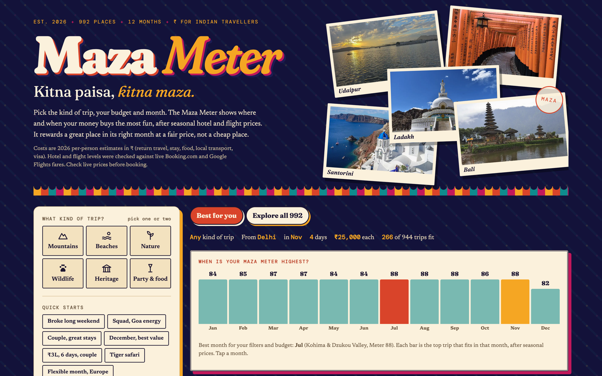

# Maza Meter

**Kitna paisa, kitna maza.** Pick the kind of trip, your budget and the month. Maza Meter shows where and when your money buys the most fun.

**Live:** [maza-meter-site.vercel.app](https://maza-meter-site.vercel.app)



## What it does

- Compares **992 places** across India and abroad for Indian travellers, month by month.
- Scores every trip with a seasonal **Maza Meter** built from vibe, weather, fair price, views, crowds and how easy it is to get there. Budget only decides what fits.
- Prices each trip per person in ₹: return travel, stay, food, local transport and visa, adjusted for the season.
- Shows the best month for your filters, then a detail page per place with stays, a day plan and the cost from your city.
- Quick starts like "Broke long weekend", "Squad, Goa energy" and "₹3L, 6 days, couple".

## How it works

- Hotel price levels were checked against live Booking.com listings for 49 places, and the flight formula was fitted to real Google Flights fares.
- Every place was researched and fact-checked, and every photo was reviewed by eye. Photos come from Wikimedia Commons.
- A QC script checks 1,536 view combinations and every detail page before a release, so no filter ever shows a trip that doesn't fit.
- The whole app ships as one static page plus WebP photo sprites. No backend, no tracking.

## Run it

```bash
npx serve public
```

Or deploy the folder as is: `vercel.json` serves `public/`.

**Stack:** vanilla JS, HTML, CSS, WebP sprite sheets, Vercel.

Costs are 2026 estimates. Check live prices before booking.
